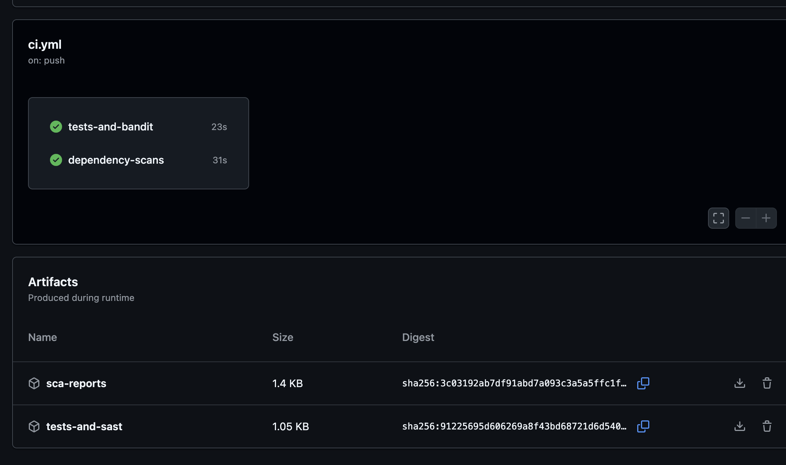
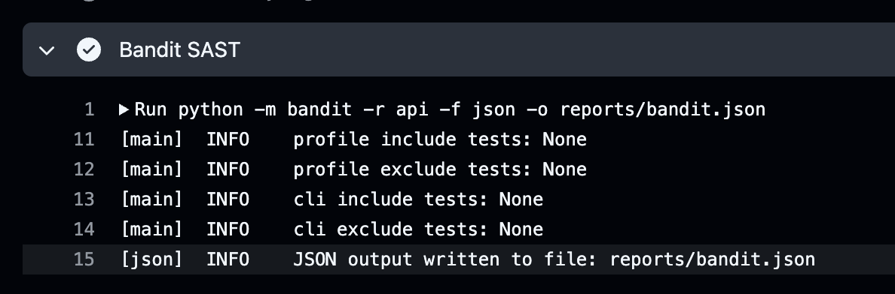
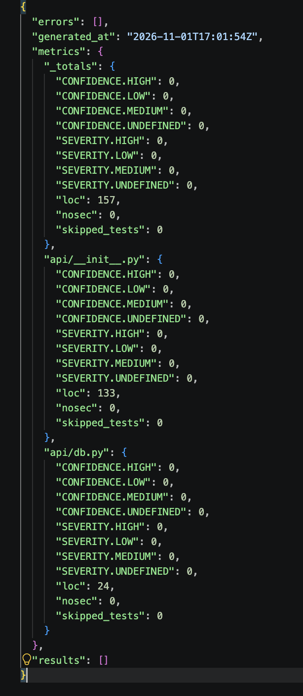
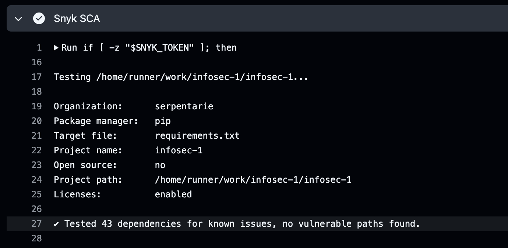
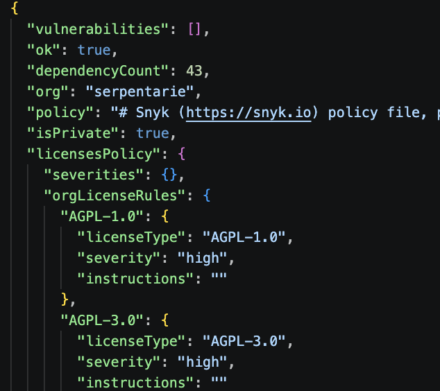

# Защищенное REST API

Учебный API заметок на Python и Flask. Данные хранятся в SQLite, зависимости устанавливаются через pip.
Пароль задается при создании пользователя.

## API

| Метод | Тело запроса | Результат |
|---|---|---|
| `POST /auth/login` | `{"username":"alice","password":"пароль"}` | `200`: JWT в поле `access_token` |
| `POST /api/data` | `{"text":"заметка"}` | `201`: созданная заметка в поле `data` |
| `GET /api/data` | Не требуется | `200`: список собственных заметок в поле `data` |

Для работы с заметками передается заголовок `Authorization: Bearer JWT`.
Токен действует 15 минут. Без токена или с недействительным токеном — `401 Unauthorized`.

## Меры защиты

- Защита от SQLi: запросы к SQLite параметризованы: значения передаются отдельно от SQL через placeholders `?`. Конкатенация пользовательских данных с SQL не используется.
- Защита от XSS: функция `serialize` экранирует текст заметок через `html.escape(..., quote=True)` при создании и получении заметок.
- Защита от Broken Authentication: после успешной проверки логина и пароля `POST /auth/login` выдает JWT на 15 минут. Общий декоратор `authenticated` выполняет роль middleware: проверяет JWT на обоих защищенных эндпоинтах (`GET /api/data`, `POST /api/data`) и возвращает `401` при отсутствии или недействительности токена. Проверяются подпись, алгоритм HS256, срок действия, issuer и audience. Пароли не хранятся в открытом виде: `generate_password_hash(..., method="scrypt")` создает хэш с солью, а `check_password_hash` проверяет пароль при входе.

## CI/CD

GitHub Actions запускает проверки при push и pull request:

- **Bandit** — статический анализ кода (SAST).
- **Snyk** — проверка зависимостей (SCA).

## Результаты CI

[Успешный запуск pipeline](https://github.com/serpentarie/infosec-1/actions/runs/41329306542).

Тесты, Bandit, pip-audit и Snyk завершились успешно.
Bandit не обнаружил проблем в коде, pip-audit — известных уязвимостей зависимостей,
Snyk — уязвимостей высокого и критического уровня.

Общий результат запуска и сохраненные артефакты:

Успешный шаг SAST:

Отчет Bandit: ошибки анализа и найденные проблемы отсутствуют.

Успешный шаг SCA:

JSON-отчет Snyk:

